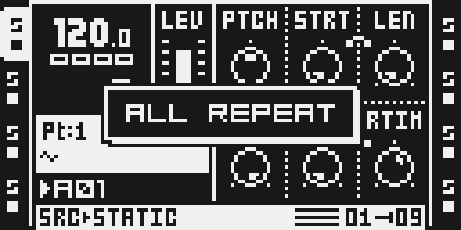

# Play Modes

Version: `0.2.0-experimental` · author: [@devilfish707](https://github.com/devilfish707) · STEP REPEAT: [@pgstath](https://github.com/pgstath) · source: [pgstath/Octaplay `step-repeat`](https://github.com/pgstath/Octaplay/tree/step-repeat), a fork of [devilfish707/Octaplay](https://github.com/devilfish707/Octaplay)

The sequencer's playhead in six directions, plus STEP REPEAT (hold trig
keys to loop those steps), per pattern, shared by every track or set per
track. ColdFire-only (no DSP code, no effect slot), for original OS 1.40C.

**Experimental.** Played on the author's MKII in test images (builds 12–24,
3–8 Oct 2026); not stress-tested, chip timing unmeasured. STEP REPEAT
(0.2.0) is host-tested and run under the ColdFire port only; it has not
been played on a unit. See [TESTING.md](TESTING.md).

## Overview

| mode | 16 steps play as |
|---|---|
| NORMAL | 1 2 3 … 16, 1 2 3 … (stock) |
| REVERSED | 16 15 14 … 1, 16 15 … |
| PINGPONG | 1 … 16 15 … 2, 1 … 16 15 … 2: the end steps play once |
| PINGPONG 2 | 1 … 16 16 … 1, 1 … 16 …: the end steps play twice |
| RANDOM | any step each time; a step can repeat |
| SHUFFLE | every step once per pass, in a new order every pass |
| REPEAT | NORMAL until trig keys are held while playing; then only the held steps, in step order, round and round (hold 5 and 8: 5 8 5 8 …) |

Every pattern of every bank has its own modes. With the pattern's SCALE MODE
on NORMAL, one mode is shared by every track, and RANDOM / SHUFFLE move all
tracks through the same order. With SCALE MODE on PER TRACK, each track has
its own: T1–T8 and the MIDI tracks M1–M8. Switching SCALE MODE back keeps
both: the shared mode returns, and the per-track modes wait for the next
PER TRACK use.

The stock playhead keeps counting as always; the module only decides which
step plays at each position. Everything a step carries moves with it: its
trig or trigless trig, trig condition, micro-timing, swing bit and parameter
locks. Tempo, track length and scale, the pattern end, chains and CHAIN
AFTER stay stock. The trig LEDs, live recording and lock editing follow the
step you hear.

**STEP REPEAT.** A track in REPEAT plays NORMAL until you hold trig keys
while the sequencer runs. From the track's next step it then plays only the
held steps, in step order, one per track step: hold TRIG 5 and TRIG 8 and
it plays 5 8 5 8 …; hold one key and that step plays every step. The stock
playhead keeps counting underneath, so when you let go the track goes on
from the step it would have reached had you never held anything. A key
pressed or let go mid-loop joins or leaves the loop in its place. Under
NORMAL scale mode every track repeats (audio and MIDI); under PER TRACK the
tracks set to REPEAT; a press is taken when the current track (MIDI mode:
M1–M8) is in REPEAT. Only while playing, in TRACKS trig mode, with GRID REC
and LIVE REC off. Steps past a track's length are left out; on patterns
longer than 16 steps the keys name the page the track's playhead is on when
the hold starts. STOP, PLAY and a pattern change end the loop.

## Controls

No knob and no effect slot (`controls` is empty). The module applies
automatically when included in a build.

| action | result |
|---|---|
| hold [TRACK n], press [UP] | the mode one row up the list (towards NORMAL) |
| hold [TRACK n], press [DOWN] | the mode one row down (towards REPEAT) |
| REPEAT, playing: hold [TRIG] keys | the track loops the held steps |
| REPEAT: let go of the [TRIG] keys | the track goes on where the stock playhead is |

The list is NORMAL, REVERSED, PINGPONG, PINGPONG 2, RANDOM, SHUFFLE, REPEAT
and does not wrap. A one-second popup shows the result: `ALL PINGPONG` under NORMAL
scale mode (any TRACK key changes the shared mode), `T3 PINGPONG` or
`M2 REVERSED` under PER TRACK (MIDI mode addresses M1–M8). Default NORMAL.
The keys change the pattern that is playing (or selected while stopped);
the change takes effect from the next step.

## Usage

- REVERSED on a melodic MIDI track turns a phrase backwards without
  re-programming it.
- PINGPONG on a sliced break plays it out and back: 30 steps of material
  from 16; PINGPONG 2 gives 32, with a doubled hit at each turn.
- SHUFFLE keeps every hit of a groove but re-orders it every pass; RANDOM
  lets steps repeat and others drop out.
- With PER TRACK scale mode and different lengths, a 5-step PINGPONG hat
  against a 16-step NORMAL kick drifts in and out of phase.
- REPEAT on a drum or MIDI track: hold one step for a roll, or two or three
  for a stutter, and let go to land back in time with the rest of the
  pattern.

PLAY and every pattern change start each track from its first step again
(REVERSED from its last) and draw a new RANDOM / SHUFFLE order.

**Per pattern and saved with the project.** The modes follow the pattern:
switching patterns (also in a chain) brings each pattern's own. Pattern
copy (FUNC + REC) and paste (FUNC + STOP) take them along, undoing a paste
brings the old ones back, and clearing a pattern (FUNC + PLAY) sets it back
to NORMAL. They are written to `project.work` as one comment line per
pattern that is not all NORMAL, `#PLAY_MODES=A01:` and 17 digits (the
shared mode, T1–T8, M1–M8; 0 NORMAL, 1 REVERSED, 2 PINGPONG, 3 RANDOM,
4 SHUFFLE, 5 PINGPONG 2, 6 REPEAT; 0.1.x reads a 6 as NORMAL), whenever the Octatrack writes the project's
settings: PROJECT > SAVE (copied to `project.strd`), SYNC TO CARD, PROJECT >
CHANGE. Loading or reloading reads them back; a project without them loads
as all NORMAL. A power cycle reads no project file, so the whole table is
also kept in battery-backed RAM, as stock keeps CHAIN AFTER. Stock firmware
reads the lines as comments, so the projects still open on a stock OS (and
lose the lines at their next save there).

**MASTER LENGTH.** Under PER TRACK, MASTER LENGTH restarts every track after
that many master steps (default 16), so a 20-step track never gets past
step 16 in any mode. Each mode works on the steps a track actually reaches
before that restart: REVERSED then plays 16 → 1, the mirror of what NORMAL
plays. Set MASTER LENGTH to INF to let each track run its full length.
Each track also follows where the stock playhead really wraps, so a mode
always works on the steps the track actually plays; NORMAL is always the
stock step. When MASTER LENGTH starts the tracks over, PINGPONG and
PINGPONG 2 start their bounce again from step 1, RANDOM and SHUFFLE a new
order.
With INF a pattern never reaches its end, so a queued pattern change waits
for CHAIN AFTER; a pattern on USE PAT SET. with PAT.LEN never changes
(stock behaviour): choose USE PRJ SET. or give it its own CHAIN AFTER.

## Quick tutorial

1. Include Play Modes in your build and load a pattern with a trig on step 1 only; SCALE MODE NORMAL.
2. Hold TRACK 1, press DOWN once: ALL REVERSED. Press PLAY: the trig sounds on the last step of every bar, and the trig LEDs walk 16 → 1.
3. Hold TRACK 1, press DOWN twice more: ALL PINGPONG 2: the trig sounds twice in a row at every turn back to step 1. Hold TRACK 1 and press UP until ALL NORMAL to return to stock playback.
4. Hold TRACK 1 and press DOWN until ALL REPEAT. Press PLAY, then hold TRIG 5 and TRIG 8: every track loops steps 5 and 8. Let go: the pattern goes on in time, from where it would have been. Hold TRACK 1 and press UP until ALL NORMAL to give the trig keys back to stock.

## Compatibility and limitations

- Base: original OS 1.40C. Played on an MKII; the MKI shares the sequencer
  and key map layout but is untested.
- Composes with EUCLID and SCALE QUANTIZER by design: their stubs at
  `0x4009c3d4` and `0x400866cc` / `0x400867a2` / `0x400888aa` return into
  this module's sites. Other combinations are untested (`module:verify`
  builds them).
- Does not combine with octabam's PLOCKS P2 (not in this catalog): both use
  battery RAM `0x100f8600..` and the 20 pattern-copy memcpy sites.
- Deliberate changes to stock flows: TRACK held + UP / DOWN is consumed (it
  changes the mode instead of reaching the stock arrow handler);
  `project.work` gains `#PLAY_MODES=` comment lines. Without a mode other
  than NORMAL, playback is stock. To turn it off, set every pattern back to
  NORMAL or leave the module out of the build.
- Stock-flow change (0.2.0, REPEAT only): while the sequencer plays and the
  current track is in REPEAT, the trig keys in TRACKS trig mode belong to
  the repeat, so keys 1–8 no longer trigger tracks (and 9–16 lose their
  TRACKS-mode use). Who: only a musician who chose REPEAT for that pattern
  and track. Why: a hold must not also fire the tracks; an own trig mode or
  a new key combination would need stock code no event shares yet. What
  you see: the held steps loop, and the trig keys do not audition tracks.
  Off: set the mode back from REPEAT (TRACK + UP), or stop the sequencer.
  Untouched, checked under the ColdFire port: stopped, GRID REC (the keys
  edit trigs), LIVE REC (they record) and CHROMATIC; a key whose press stock
  saw is released to stock. Not yet checked on a unit.
- REPEAT: on patterns longer than 16 steps the keys name the playhead's
  page, not the page the trig LEDs show. MIDI note lengths over repeated
  steps, micro-timing, conditions and slides on repeated steps are
  untested.
- Copying a single track does not copy that track's mode. PROJECT > NEW may
  keep the previous project's modes (untested).
- Swing follows the step that plays (stock reads the swing bit of the step
  it is given). Trig conditions keep counting stock passes.
- Micro-timing, trig conditions, slides and live recording were not checked
  on purpose; MIDI tracks only briefly.
- Like every DRAM module, the build gives up about 10 MB of sample memory to
  the platform reserve.

## Tests and measurements

`python3 verify.py` (the module's gate) compiles the engine and the
firmware glue for the host and runs their suites: every mode for lengths
1–64, SHUFFLE a permutation every pass, RANDOM's spread, look-ahead equal to
what then plays, what is prepared while stopped equal to what PLAY plays,
the popup text, scale modes, per-track lengths and the MASTER LENGTH cut,
PLAY and pattern-switch restarts, per-pattern rows, the project lines,
battery RAM over a simulated power cycle, pattern copy / paste / undo and
clear, and STEP REPEAT's held steps, release, look-ahead and key handling.
With `m68k-elf-gcc` on the PATH it also compiles the ColdFire unit,
refuses any call outside it and checks `playmodes.s` is current. Hardware
results, resources and what is not tested: [TESTING.md](TESTING.md). How
every firmware address was found: [INVESTIGATION.md](INVESTIGATION.md).

## Authorship and licences

Original code and illustration by devilfish707, MIT ([LICENSE](LICENSE)).
Firmware addresses are cited from octabam (Sam Banks), SCALE QUANTIZER and
DIRECT JUMP (Tim Hastie), the KYOTI firmware notes (Zac-Kyoti) and OctaKit
(June Kiff), and read from the author's own 1.40C with the probe in the
[Octaplay repository](https://github.com/devilfish707/Octaplay) (its output
is never committed). STEP REPEAT (the REPEAT mode and its trig-key detour)
contributed by pgstath, MIT; its trig-key, GRID REC, LIVE REC and trig-mode
addresses were read from the contributor's own 1.40C (INVESTIGATION.md
section 5). No Elektron code, tables or images are included.

## Screens and audio

Captured in the headless emulator from the 0.2.0 native composition
(`media/capture.json`), black-and-white LCD pixels; the first two are
byte-identical to their 0.1.1 captures:

The thumbnail is an illustration, not an Octatrack screen. No audio.
